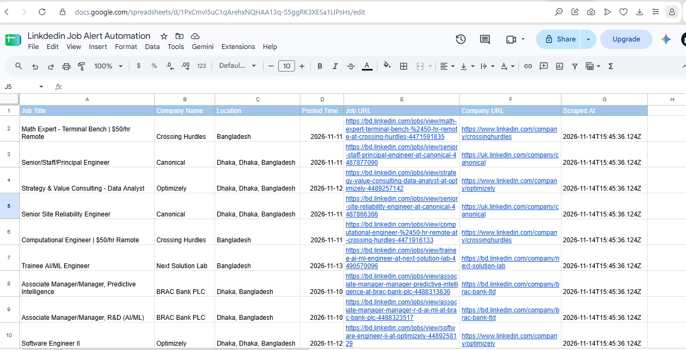

# LinkedIn Job Alert Automation (n8n + Apify + Google Sheets)

An n8n workflow that accepts a job search request via **Webhook**, scrapes LinkedIn jobs with an **Apify actor** (using only **HTTP Request** nodes, no Apify node), waits for the run to finish, and saves the results to **Google Sheets**. An AI node then writes a 2–3 sentence hiring summary.

## Flow

```
Webhook → Validate Input → Input Valid? ─ no ─► Respond 400
                              │ yes
                   Respond 202 → Start Apify Run
                              ▼
        ┌──► Wait 20s → Check Run Status → Evaluate Status → Route by Status
        │                                                      │
        └────────────────── still running ─────────────────────┤
                                                               │ SUCCEEDED
   Fetch Dataset → Process Data → Save Jobs (Sheet)
        → Prepare AI Prompt → AI Job Summary → Save Summary (Sheet)

   FAILED / ABORTED / TIMED-OUT / over 15 minutes
        → Build Failure Info → Log Failed Run → Stop and Error
```

## 1. Prerequisites

- n8n (cloud or self-hosted), v1.x or newer
- Apify account (https://apify.com) and an API token
- Google account (for Google Sheets)
- Optional (bonus): Google Gemini API key (free from https://aistudio.google.com) or swap the model node for OpenAI/Anthropic

## 2. Create the Google Sheet

Create one spreadsheet with **three tabs**. Row 1 must contain these exact headers:

| Tab | Headers (row 1) |
|---|---|
| `Jobs` | `Job Title`, `Company Name`, `Location`, `Posted Time`, `Job URL`, `Company URL`, `Scraped At` |
| `Summaries` | `Date`, `Search`, `Total Jobs`, `Summary` |
| `Errors` | `Time`, `Run ID`, `Status`, `Reason`, `Search` |

Copy the Sheet ID from the URL: `https://docs.google.com/spreadsheets/d/<SHEET_ID>/edit`.

## 3. How to configure the Apify API token

1. Log in to Apify Console → **Settings → API & integrations** → copy your **Personal API token**.
2. In n8n go to **Credentials → Create credential → Header Auth**.
   - Name: `Apify API Token`
   - Header **Name**: `Authorization`
   - Header **Value**: `Bearer YOUR_APIFY_TOKEN`
3. Open each HTTP Request node (`Start Apify Run`, `Check Run Status`, `Fetch Dataset`) and select this credential.

The token is never hard-coded in the workflow JSON.

## 4. Import and configure the workflow

1. n8n → **Workflows → Import from file** → choose `linkedin-job-alert-workflow.json`.
2. Create/select credentials:
   - **Google Sheets OAuth2** for the 3 Google Sheets nodes
   - **Apify API Token** (Header Auth) for the 3 HTTP nodes
   - **Google Gemini (PaLM) API** for the `Gemini Chat Model` node
3. In all 3 Google Sheets nodes replace the Document ID with your `SHEET_ID` (or pick the spreadsheet from the list).
4. Save, then **Activate** the workflow.

### Actor used

`curious_coder/linkedin-jobs-scraper` (API id `curious_coder~linkedin-jobs-scraper`, pay-per-result, about $2 per 1,000 results). The workflow builds a LinkedIn search URL from the webhook input and sends `{ "urls": [...], "count": N, "scrapeCompany": false }`. The actor requires `count` of at least 10, so smaller limits are rounded up for the scrape and the dataset fetch is capped at your `limit`.

To use another actor, change `actorId` in the `Validate Input` node and adjust the JSON body in `Start Apify Run` to match that actor's input schema (see the actor's **Input** tab). `Process Data` accepts several common output field names.

## 5. How to trigger the webhook

- **Test URL** (workflow open in editor, click *Listen for test event*): `https://mamunmazid1.app.n8n.cloud/webhook-test/linkedin-job-alert`
- **Production URL** (workflow active): `https://mamunmazid1.app.n8n.cloud/webhook/linkedin-job-alert`

```bash
curl -X POST "https://mamunmazid1.app.n8n.cloud/webhook/linkedin-job-alert" \
  -H "Content-Type: application/json" \
  -d '{"jobTitle":"Python Developer","location":"Remote","limit":20}'
```

You can also use Postman or any HTTP client (Method: POST, Body: raw JSON).

### Sample payload

```json
{
  "jobTitle": "Python Developer",
  "location": "Remote",
  "limit": 20
}
```

Optional field: `"publishedAt"`: `"r86400"` (last 24 h), `"r604800"` (last 7 days, default), `"r2592000"` (last 30 days).

### Responses

- `202` `{"status":"accepted", ...}` – scraping started (the workflow continues in the background)
- `400` `{"status":"error","errors":["jobTitle is required"]}` – invalid input

## 6. How it works

- **Waiting for completion:** `Wait 20s → Check Run Status → Evaluate Status → Route by Status` loops until the run is `SUCCEEDED`. The dataset is fetched only after success.
- **Failure handling:** `FAILED`, `ABORTED`, `TIMED-OUT`, a run exceeding 15 minutes, or an HTTP error (after 3 automatic retries) is routed to `Build Failure Info`, logged in the `Errors` tab, and the execution ends with a clear error message.
- **Data processing:** removes items without title/URL, de-duplicates by Job URL, and maps fields to the sheet columns.
- **No duplicates in the sheet:** `Save Jobs` uses *Append or Update* matched on `Job URL`, so re-running the same search updates rows instead of duplicating them.
- **Bonus AI summary:** counts the top companies and locations in code (so numbers are exact), then asks the LLM to write a 2–3 sentence summary, saved to the `Summaries` tab.

## 7. Testing checklist

1. Valid request → check the `Jobs` tab fills with rows and `Summaries` gets a summary.
2. Missing `jobTitle` → expect HTTP 400.
3. Failure test: temporarily break the token or `actorId` → expect a row in the `Errors` tab and a failed execution.
4. Take a screenshot of the final `Jobs` sheet and add it to the repo as `screenshots/final-sheet.png`.

## 8. Notes

- LinkedIn scrapers usually need Apify residential proxies; this may require a paid Apify plan or credits. If runs fail with a proxy/blocked message, check the run log in Apify Console.
- Apify actors can change their input/output fields or become unavailable. Re-check the actor page if the run output looks different.
- If the dataset is empty (no jobs match), the workflow ends quietly without writing rows.

## Screenshots



## Deliverables

- `linkedin-job-alert-workflow.json`
- Google Sheet link: https://docs.google.com/spreadsheets/d/1PxCmvI5uC1qArehxNQHAA13q-S5ggRK3XESa1LIPsHs/edit?usp=sharing
- `screenshots/final-sheet.png`
- This README
